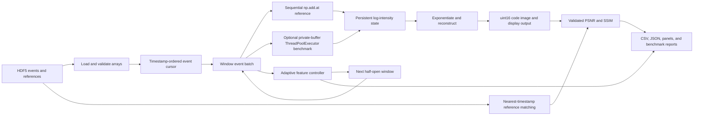

# Adaptive Event-Camera Reconstruction

This repository explores adaptive temporal batching of event-camera data and
reconstructs grayscale images by applying event updates to a persistent
intensity state. It contains a primary first-20-window pipeline, an earlier
prototype pipeline, fixed-window exploratory utilities, and isolated
sequential-versus-threaded experiments.

> **Scope note:** The experiments use one EventHDR-style HDF5 sequence,
> `data/5.h5`. The event contrast threshold and the interpretation of stored
> grayscale codes as intensity are assumptions, not sensor-calibrated
> quantities. Reported PSNR and SSIM are code-domain comparisons, not
> radiometric-quality claims.

## Project overview

An event camera reports brightness changes at pixel locations and timestamps,
not a conventional intensity frame for every moment. This project investigates
how to group those events into variable-duration windows and use each group to
update a grayscale image state.

The main objectives are to:

- adapt the next event-window duration using event-derived activity features;
- preserve and update a state across consecutive, non-overlapping windows;
- compare each reconstruction with the temporally closest reference image when
  the comparison passes validity checks; and
- measure whether a private-buffer `ThreadPoolExecutor` implementation can
  accelerate event accumulation without changing outputs.

The project implements these workflows and records experimental results. It
does **not** establish a calibrated event-camera reconstruction model or show
that Python threads accelerate this workload; the saved benchmarks show slower
reconstruction as worker count increases.

## Key features

- HDF5 loading and validation of ordered event arrays and timestamped
  grayscale references.
- Adaptive event windows with event rate, 8 × 8 spatial activity,
  concentration, a centroid-based motion proxy, and change features.
- Persistent log-intensity state initialized from the last reference image
  strictly before the first event.
- A sequential event update using `numpy.add.at()` retained as the independent
  reference implementation.
- Isolated `ThreadPoolExecutor` experiments using worker-local count buffers,
  with one-, two-, four-, and eight-worker configurations.
- Per-window CSV/JSON logging, reconstructed code-value PNGs, display images,
  comparison panels, PSNR/SSIM evaluation, and benchmark graphs.
- Correctness checks for window boundaries, event assignments, state values,
  and output pixels.

## How it works

### Adaptive windows

The main pipeline starts with a 2 ms window. Its current window is processed
first; event-derived features then determine the **next** window duration.
Durations are limited to 0.5–10 ms. After four warm-up windows, urgency at or
above 0.65 shortens the next window by a factor of 0.75; urgency at or below
0.25 lengthens it by 1.25; intermediate urgency retains the duration.

For each populated window, the controller computes:

| Feature | Meaning |
|---|---|
| Event rate | Events divided by the current window duration |
| Active-cell fraction | Fraction of occupied cells in an 8 × 8 sensor grid |
| Spatial concentration | Sum of squared proportions of events per grid cell |
| Motion proxy | Distance between event-coordinate centroids in temporal halves |
| Change score | Change in event rate and active-cell fraction relative to the previous window |

Features are normalized against percentile ranges from the run's history. The
urgency score combines available normalized features with weights 0.30 (rate),
0.20 (spatial activity), 0.30 (motion), and 0.20 (change), renormalizing over
available features. During warm-up, the controller conservatively retains the
window duration.

### Event assignment and reconstruction

Windows are sequential and use half-open timestamp intervals:
`[window_start, window_end)`. A monotonically advancing cursor assigns each
event to a window once; events exactly at a boundary belong to the following
window. The full-dataset run extends the final endpoint enough to include the
last event.

The primary reconstruction pipeline:

1. Selects the latest reference timestamp strictly earlier than the first
   event and initializes state as
   `log(max(reference_code_value, 1e-6))`.
2. Applies each window's events to a copy of the persistent state. A `true`
   polarity adds 0.05 and a `false` polarity subtracts 0.05 in log space.
   The state is floored at `log(1e-6)` after updates.
3. Converts the updated log state back to grayscale code values with `exp`.
   The state is carried forward; it is not reset between windows.
4. Matches the window-end target timestamp to the closest reference. Metrics
   are computed only when temporal alignment, image shape, grayscale type,
   dtype, and code-value range pass validation.
5. Saves a uint16 code-value image for metrics and a consistently scaled
   display image. The display scale comes from the initialization image and is
   separate from the reconstruction state.

The fixed threshold `0.05` and the use of stored codes as proportional to
intensity are documented modeling assumptions. Dataset metadata does not
calibrate either quantity.

### Architecture



The threaded branch is experimental. The first-20 benchmark keeps the original
sequential implementation as a separate reference; its one-worker threaded
configuration uses the threaded implementation. In the full-dataset benchmark,
the one-worker configuration uses the original sequential path, while the
two-, four-, and eight-worker configurations use private buffers.

## Technology stack

| Technology | Use |
|---|---|
| Python | Pipeline, controller, experiment runners, and tests |
| NumPy | Event arrays, state updates, feature calculations, PSNR/SSIM |
| h5py / HDF5 | Event and reference-image input |
| Pillow | Grayscale PNG output and image panels |
| `concurrent.futures.ThreadPoolExecutor` | Experimental parallel accumulation |
| psutil | Process CPU and memory measurements in experiments |
| Matplotlib | Experiment graphs |
| OpenCV | Exploratory scene-classification/optical-flow utility and recorded environment metadata |
| `unittest` | Repository tests |

The saved full-dataset experiment records Python 3.13.1, NumPy 2.5.4,
h5py 3.16.0, Pillow 13.0.0, psutil 7.2.2, and OpenCV 5.0.0. The first-20
performance report also records Matplotlib 3.11.2. These are the versions in
the recorded experiment environment, not declared dependency pins.

## Repository structure

```text
.
├── adaptive_first20_pipeline/
│   ├── experiment.py                 # Main persistent-state pipeline and metrics
│   └── __main__.py                   # python -m adaptive_first20_pipeline entry point
├── adaptive_window_pipeline/
│   ├── controller.py                 # Earlier signed-event-image prototype
│   └── run_pipeline.py               # CLI for that prototype
├── data/                             # Locally supplied HDF5 sequences; ignored by Git
├── initial_things/                   # Exploratory inspection/baseline utilities
├── results/
│   ├── adaptive_first20/             # First 20 outputs, summary, logs, images
│   ├── adaptive_window_pipeline/      # Earlier prototype frames and CSV
│   ├── inspection/                    # Dataset inspection artifacts
│   ├── multithreading_experiment/    # First-20 thread comparison code and reports
│   └── full_dataset_adaptive_multithreading_experiment/
│       ├── code/                     # Isolated runner and report utilities
│       ├── reports/                  # Correctness, timing, and environment reports
│       └── graphs/                   # Saved benchmark graphs
├── tests/
│   └── test_adaptive_reconstruction.py
├── adaptive_first20_methodology.md
├── adaptive_window_closest_timestamp_methodology.md
├── .gitignore
└── README.md
```

`initial_things/` contains exploratory scripts, including fixed-time and
fixed-event-count baselines and optical-flow-based scene classification. It is
not the entry point for the persistent-state pipeline. Several of these legacy
scripts expect `initial_things/data/1.h5`, which is not the documented
`data/5.h5` location; they may need a dataset-path adjustment before use.

There is currently no root `requirements.txt`, `pyproject.toml`, or setup
configuration. The root methodology files describe experiment intent and
assumptions; the Python implementation and saved reports are authoritative for
what ran.

## Dataset information

The experiments use an HDF5 file with this structure:

```text
/
├── events/
│   ├── xs       # x coordinate per event
│   ├── ys       # y coordinate per event
│   ├── ts       # timestamp per event, seconds
│   └── ps       # polarity per event
└── images/
    ├── image000000000
    ├── image000000001
    └── ...
```

For the measured `data/5.h5` sequence, the recorded schema is:

| Item | Recorded value |
|---|---|
| Events | 5,647,823 |
| `xs`, `ys` | `int16` coordinates |
| `ts` | `float64`, ascending timestamps in seconds |
| `ps` | Boolean polarity |
| Sensor / references | 240 × 320 pixels |
| References | 401 grayscale `uint16` images |
| Reference cadence | Approximately 2 ms median interval |
| Sequence duration | Approximately 0.8 seconds |

Reference datasets have a `timestamp` attribute and may include `event_idx`,
`size`, and `type` attributes. The primary loader requires `events` and
`images`; it validates that event arrays have matching lengths and ascending,
finite timestamps.

Large HDF5 files are not included in GitHub and are ignored by `.gitignore`.
Obtain the dataset from an authorized source and place the sequence at
`data/5.h5` for the commands below. The project does not include credentials
or a bundled dataset-download script. The other locally observed dataset names
are not evidence that every sequence has the same schema; inspect a sequence
before using it.

The data layout and code-value normalization are discussed in the project
methodology with reference to the upstream
[EventHDR project](https://github.com/yunhao-zou/EventHDR). The project does
not claim a calibrated sensor white level or radiometric interpretation for
the stored grayscale values.

## Installation and setup

Use Python 3.13 to match the recorded experiment environment where possible.
The repository does not declare a minimum supported Python version or pin
dependencies.

From the project root in Windows PowerShell:

```powershell
py -3.13 -m venv .venv
.\.venv\Scripts\Activate.ps1
python -m pip install --upgrade pip
python -m pip install numpy h5py Pillow psutil matplotlib opencv-python
```

The main reconstruction pipeline needs NumPy, h5py, and Pillow. The isolated
benchmark/report tools additionally use psutil and Matplotlib; the full-dataset
runner imports OpenCV to record its environment. There is no dependency lockfile,
so installing these unpinned package names may produce versions different from
the saved experiment environment.

Place the dataset at `data/5.h5`, then check the Python environment and run the
unit tests:

```powershell
python --version
python -m unittest discover -s tests -v
```

## Execution instructions

Run commands from the project root after installing dependencies and placing
the dataset. Generated experiment runs write to `results/`; preserve or back up
existing outputs before rerunning a command that uses one of those directories.

### Main first-20 adaptive reconstruction

The module entry point processes at most 20 windows from `data/5.h5` and writes
to `results/adaptive_first20/`:

```powershell
python -m adaptive_first20_pipeline
```

To keep an existing output directory untouched, call the same implemented
function with a separate output directory:

```powershell
python -c "from adaptive_first20_pipeline.experiment import run_experiment; run_experiment(data_path='data/5.h5', output_root='results/adaptive_first20_rerun', max_outputs=20)"
```

The output includes reconstructed display images, uint16 code-value images,
comparison panels, `adaptive_first20_log.csv`, and
`adaptive_first20_summary.json`.

### Earlier adaptive-window prototype

This separate CLI builds a signed event-count image for each window; it is not
the persistent log-intensity reconstruction described above. Supply the actual
dataset explicitly because its default `data/1.h5` is not present in the
documented dataset set.

```powershell
python -m adaptive_window_pipeline --data data/5.h5 --output-dir results/adaptive_window_pipeline --initial-window-ms 2.0
```

It writes frames and `window_summary.csv`. The implementation caps this run at
1,000 windows.

### First-20 multithreading benchmark

Run the one-window correctness check and then the benchmark, which executes a
warm-up and three measured repetitions for each of 1, 2, 4, and 8 worker
configurations:

```powershell
python .\results\multithreading_experiment\code\run_experiments.py --window-test
python .\results\multithreading_experiment\code\run_experiments.py
python .\results\multithreading_experiment\code\evaluate_results.py
```

The first command is the small correctness check only. The full benchmark and
evaluation write under `results/multithreading_experiment/` and can replace
files there. The experiment runner uses `data/5.h5` directly and does not
provide a dataset-path option.

### Full-dataset adaptive multithreading experiment

The runner's default action performs hardware/resource preflight, checksum
verification, and a first-window correctness test; it does **not** launch the
full run:

```powershell
python .\results\full_dataset_adaptive_multithreading_experiment\code\experiment_runner.py
```

Preflight only:

```powershell
python .\results\full_dataset_adaptive_multithreading_experiment\code\experiment_runner.py --preflight-only
```

First-window test only (after the preflight and checksum checks):

```powershell
python .\results\full_dataset_adaptive_multithreading_experiment\code\experiment_runner.py --first-window-test
```

The full run requires an explicit flag and uses `data/5.h5`:

```powershell
python .\results\full_dataset_adaptive_multithreading_experiment\code\experiment_runner.py --full-run
```

It runs one warm-up and three measured repetitions per worker configuration.
The runner has fixed experiment paths under
`results/full_dataset_adaptive_multithreading_experiment/` and writes logs,
reports, CSV files, and graphs there. Its checksum manifest describes files
from the original experiment workspace; in a fresh clone where ignored
artifacts are absent, checksum verification can report missing files. Inspect
those reports before interpreting a run as having passed the original
workspace-integrity checks.

## Experimental results

The following values come from the saved reports in `results/`. Timing figures
are means over three measured repetitions; warm-ups are excluded. Results are
specific to the recorded machine and sequence.

### Full 5,647,823-event sequence

The actual reconstruction produced 1,577 windows. The one-worker configuration
uses the original sequential `numpy.add.at()` path; 2, 4, and 8 workers use
private-buffer accumulation.

| Workers | Mean reconstruction time | Speedup vs. 1 worker | Mean total pipeline time |
|---:|---:|---:|---:|
| 1 | 30.13 ± 0.57 s | 1.000× | 287.72 ± 5.31 s |
| 2 | 39.29 ± 5.74 s | 0.767× | 314.04 ± 36.91 s |
| 4 | 116.33 ± 2.20 s | 0.259× | 845.91 ± 58.32 s |
| 8 | 131.85 ± 3.22 s | 0.229× | 941.66 ± 15.15 s |

Threaded outputs matched the sequential output at every window: maximum and
mean absolute pixel difference were both zero, with PSNR of infinity and SSIM
of 1.0 versus the sequential images. Adaptive boundaries and event assignments
also matched. This correctness result does not imply a performance gain:
reconstruction was slower with every tested multiworker configuration.

Against the unchanged-initialization baseline, the full-dataset event-updated
outputs scored mean PSNR **35.3136 dB** and SSIM **0.7175**, versus **34.8182
dB** and **0.6924** for the baseline. These reference comparisons are in
normalized uint16 code space, use a nearest-timestamp rule, and are not
radiometric measurements. The summary contains 1,576 valid scored windows.

### First-20-window thread experiment

This separate experiment covers the first 20 windows (101,769 events). The
original sequential `np.add.at()` implementation is retained as a distinct
reference; all threaded configurations produced pixel-identical outputs
(maximum and mean absolute differences of zero, PSNR of infinity, and SSIM of
1.0 versus sequential).

| Threaded worker count | Mean reconstruction time | Speedup vs. threaded 1-worker |
|---:|---:|---:|
| 1 | 0.1311 ± 0.0079 s | 1.000× |
| 2 | 0.1581 ± 0.0026 s | 0.829× |
| 4 | 0.2594 ± 0.0392 s | 0.506× |
| 8 | 0.3988 ± 0.0532 s | 0.329× |

The original sequential accumulation averaged about 0.026 s, compared with
about 0.0709 s for the threaded implementation configured with one worker.
Whole-run times (about 5.585–6.239 s) include loading, PNG output, and
evaluation and should not be interpreted as event-accumulation speedup.
Measured task overlap was observed for multiple workers, but overlap is not
proof of simultaneous CPU execution or useful scaling.

### Reports and environment

Detailed CSV/JSON results, correctness reports, the read-only performance
audit, and graphs are under:

- `results/adaptive_first20/`
- `results/multithreading_experiment/reports/`
- `results/full_dataset_adaptive_multithreading_experiment/reports/`
- `results/full_dataset_adaptive_multithreading_experiment/graphs/`

The recorded full-dataset environment was Windows 11, Python 3.13.1, an
Intel Core i5-1035G1 with 4 physical cores and 8 logical processors, and
approximately 7.78 GiB RAM. See `hardware_environment.json` for the recorded
library versions and native-thread settings.

## Reproducibility

- Use the same `data/5.h5` sequence and keep its event/reference timestamps
  unchanged.
- The main pipeline fixes the initial, minimum, and maximum windows at 2 ms,
  0.5 ms, and 10 ms; the urgency thresholds, factors, feature weights, and
  four-window warm-up are constants in
  `adaptive_first20_pipeline/experiment.py`.
- The main function accepts `data_path`, `output_root`, and `max_outputs`
  (1–20). The isolated benchmark runners use fixed project-relative paths and
  worker configurations.
- For the full-data benchmark, keep one warm-up and three measured
  repetitions. The warm-up is excluded from summary averages.
- Use the same Python/library environment when comparing timings. No
  requirements lockfile is currently provided.
- Outputs and CSVs are generated artifacts. Rerunning commands in the same
  destination can replace corresponding files.
- Dataset HDF5 files and generated image/intermediate-output directories are
  excluded by `.gitignore`; textual summaries and reports are retained.
  Benchmark graph images under `results/**/graphs/` are intentionally
  preserved.

## Limitations and future improvements

### Current limitations

- The reconstruction assumes fixed log contrast `C = 0.05`; this is not
  calibrated from the HDF5 metadata.
- Stored uint16 grayscale codes are treated as proportional to intensity for
  the state update. The data does not establish a calibrated white level,
  transfer function, or exposure equivalence.
- PSNR/SSIM are code-domain comparisons after division by 65535, using an
  11 × 11 Gaussian-window SSIM implementation and closest-timestamp
  references. They do not measure calibrated radiance.
- The controller is heuristic and evaluated on one sequence for the reported
  experiments; its centroid motion proxy can be misleading for complex or
  multi-object motion.
- The tested Python thread implementation is slower than the sequential
  reference for reconstruction at the measured worker counts. Results are
  from one machine and are not a general performance guarantee.
- Legacy exploratory utilities have hard-coded dataset paths and are not all
  directly runnable against `data/5.h5`.

### Proposed, not implemented

The performance audit suggests profiling and testing persistent executor
reuse, reusable/sparse worker buffers, spatial partitioning, fewer array
temporaries, and native compiled accumulation. These are recommendations only;
the current benchmark results do not include them. Further work should also
calibrate the event threshold, validate on additional sequences, and document
dataset provenance and the supported Python/dependency versions.

## Contributors and acknowledgements

No contributor list or author metadata was found in the project documentation.
The project methodology cites the upstream
[EventHDR repository](https://github.com/yunhao-zou/EventHDR) for dataset
context and HDF5 conventions. No dataset is redistributed by this repository.
